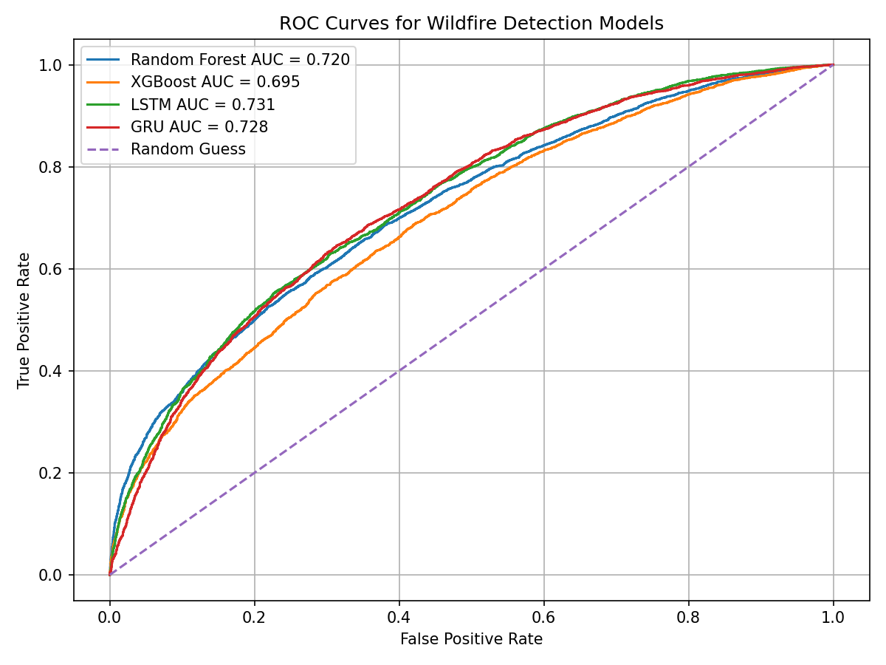
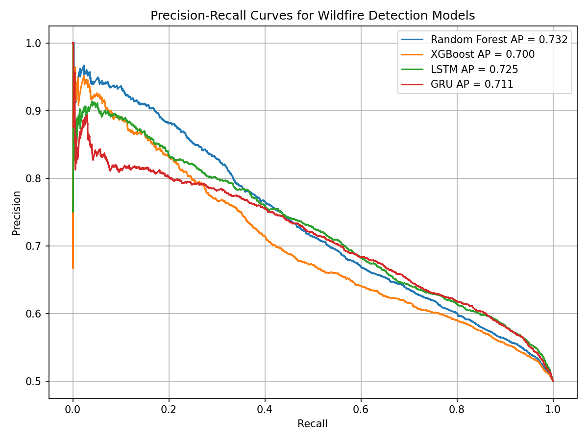
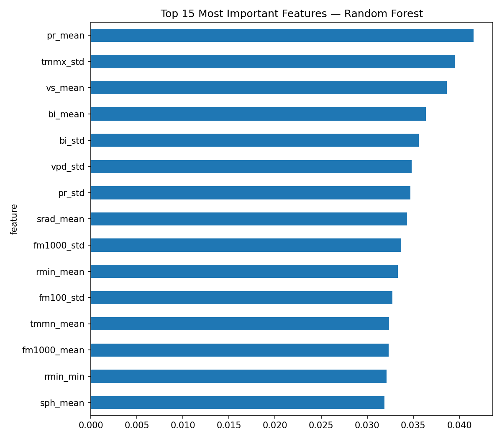
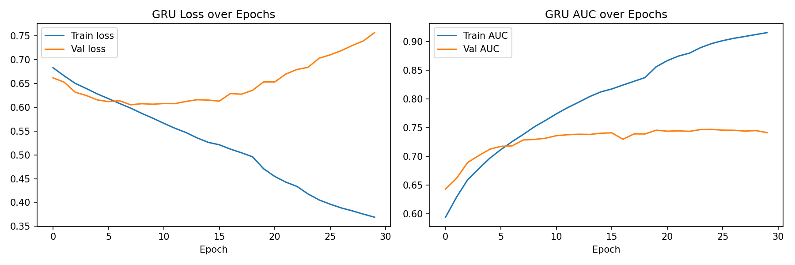

# Wildfire Prediction and Classification

An academic machine learning project analyzing 9.5 million daily environmental records to classify wildfire event windows, with an interactive Streamlit demo.

## Project Overview

The project compares classical machine learning models using aggregated weather features with deep learning models using 75-day sequences of 15 environmental variables.

The workflow includes data cleaning, feature engineering, class balancing, model training, and evaluation.

## Models
- Random Forest
- XGBoost
- Long Short-Term Memory (LSTM)
- Gated Recurrent Unit (GRU)

## Results

Reported test ROC-AUC scores:

| Model | ROC-AUC |
|---|---:|
| Random Forest | 0.720 |
| XGBoost | 0.695 |
| LSTM | 0.731 |
| GRU | 0.728 |

Evaluation also includes precision, recall, F1-score, confusion matrices, and decision-threshold comparisons.

### ROC Curves


### Precision–Recall Curves


### Feature Importance


### GRU Training Curves


## Interactive Demo

The Streamlit application lets users explore sample predictions, compare models, and inspect environmental features.

Saved models and demo samples are included through Git LFS. The full training dataset is not required to run the demo.

## Technology Stack
Python, pandas, NumPy, scikit-learn, XGBoost, TensorFlow/Keras, Matplotlib, Plotly, Streamlit, and Joblib.

## Run the Demo Locally

Install Git LFS before cloning, then run:

```bash
git lfs install
git clone https://github.com/lynnmatar590/Wildfire-Classification.git
cd Wildfire-Classification
git lfs pull
python -m pip install -r requirements.txt
cd wildfire_demo
python -m streamlit run wildfire_demo.py
```

Run the application from inside `wildfire_demo` so it can locate its model and sample files.

Saved models may require the same library versions used during training.

## Training Notebook

`WildfireDetectionProject.ipynb` contains the preprocessing, training, and evaluation workflow, with saved outputs.

To rerun training, obtain the FireCastRL GRIDMET + IRWIN dataset and place it alongside the notebook as `Wildfire_Dataset.csv`. The dataset is excluded from this repository because of its size.

Training requires substantially more memory and computation than running the saved-model demo.

## Scope and Limitations

The experimental windows include the ignition day and post-ignition observations. Results therefore describe classification of wildfire-containing windows, rather than demonstrated forecasting before ignition.

Evaluation uses an undersampled, balanced dataset; performance may differ under the natural class distribution.

## Project Context

Developed for the Artificial Intelligence course at Antonine University.

Academic team project; implementation and experimentation completed by Lynn Matar.